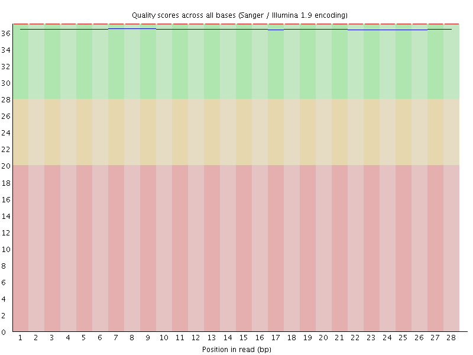
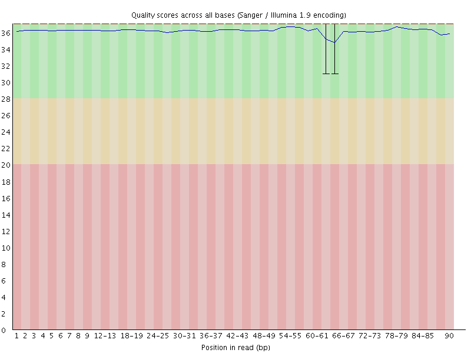
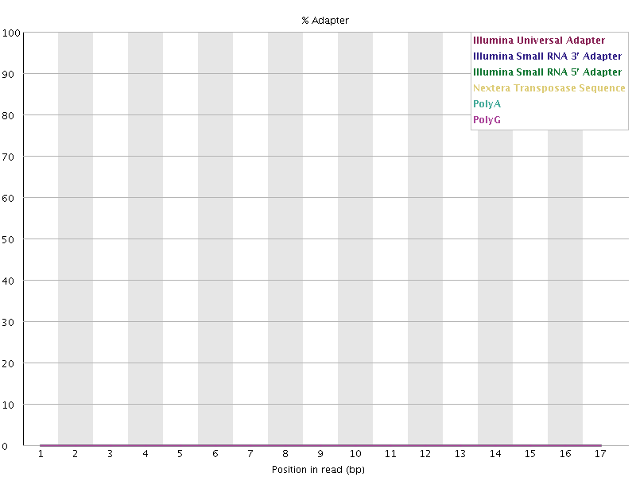
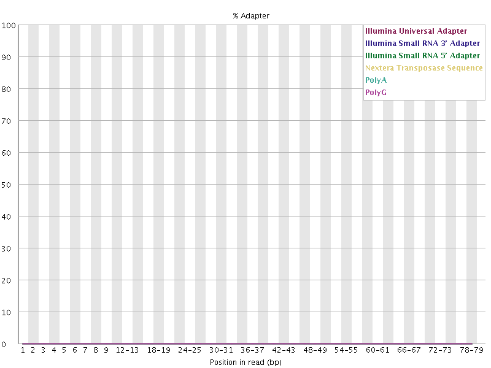
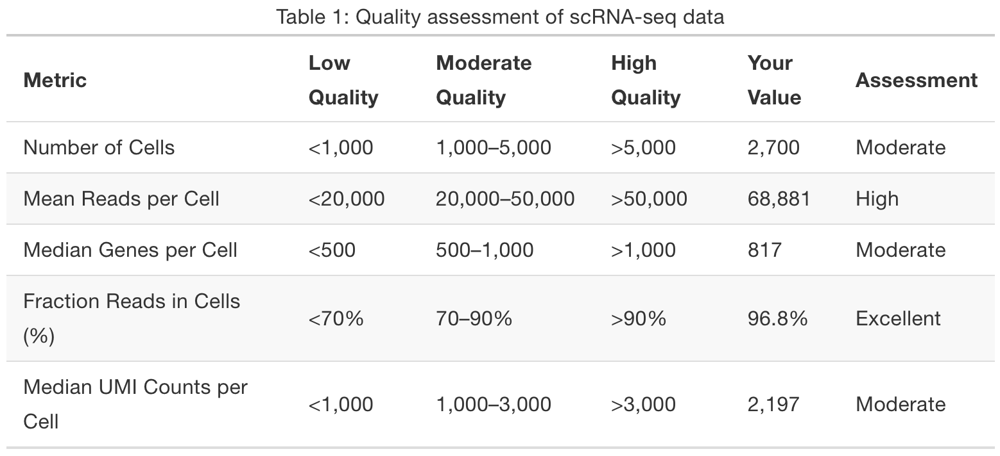
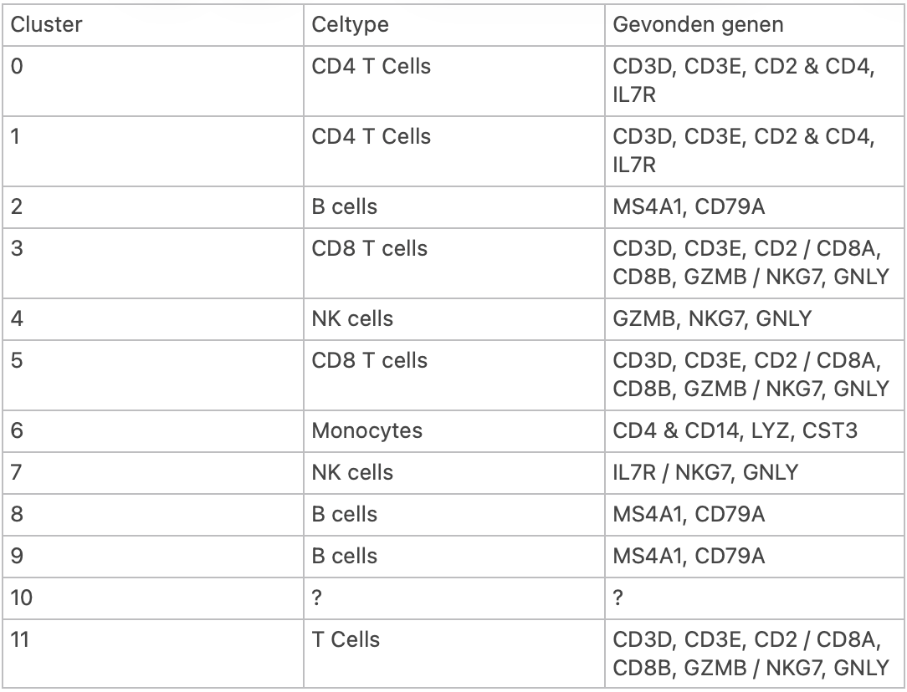

```{r Setup, include=FALSE}
knitr::opts_chunk$set(echo = TRUE, warning = FALSE, message = FALSE)
```

```{r Loading libraries, include=FALSE}
# Load the libraries
library(dplyr) # filter(), select(), mutate()
library(Seurat) # NormalizeData(), RunPCA(), FindMarkers()
library(tidyverse) # tidyr, readr
library(patchwork) # combining ggplots
library(glmGamPoi) # SCTransform()
library(ggplot2) # Violin-, scatter-, PCA plots
library(clusterProfiler) # GO-term enrichment
library(org.Hs.eg.db) # Human's genome database
library(enrichplot) # GO-term plots
```

```{r Defining paths, include = FALSE}
# Load the PBMC dataset with READ10X (Seurat function)
countmatrix_control2 <- Read10X(data.dir = "/home/daur2/scrnaseq/pbmc/lung_cancer/lung_filtered_feature_bc_matrix/")

# Load the summary of the control2
summary <- read.csv("/home/daur2/scrnaseq/pbmc/lung_cancer/lung__metrics_summary.csv")

# Load the clusters of the healthy donor
control1_clusters <- readRDS(
  "/home/daur2/scrnaseq/pbmc/healthy/control1_filtered_rds/pbmc_control1_clusters.rds")
```

---

## Introductie

Perifere Bloed Mononucleaire Cellen (PBMC) zijn immuuncellen uit het bloed waar onder andere T-cellen, B-cellen en monocyten in zitten. Wanneer er zich in het lichaam kanker manifesteert kan dit gepaard gaan met veranderingen in het immuunsysteem. PBMC's zijn hierbij een geschikte maatstaf om na te gaan welke veranderingen er in het immuunsysteem hebben plaatsgevonden voor verder onderzoek. 

Single-cell RNA sequencing (scRNA-seq) is een techniek die van individuele cellen diens genexpressie onderzoekt. Met de data die uit scRNA-seq naar voren komt kan er een overzicht gemaakt worden die laat zien welke soort cellen aanwezig zijn in een sample en diens verschillen in genexpressie; iets wat normaliter onopgemerkt blijft in bulk RNA sequencing.

Het doel van deze analyse is om de celtype-samenstelling en genexpressie van PBMC's van een longkanker patiënt te vergelijken met die van een gezond persoon (control1). De nadruk bij deze analyse wordt gelegd op CD8 T-cellen, aangezien deze onderdeel uitmaken van het adaptieve immuunsysteem en betrokken zijn bij het herkennen en vernietigen van cellen met afwijkingen zoals tumorcellen. Dit wordt gedaan door cytotoxische eiwitten en het proces heet cytotoxiciteit. Longkanker kan het immuunsysteem beïnvloeden door de signalen van het immuunsysteem te veranderen. Hierdoor kunnen CD8 T-cellen veranderingen vertonen in hun aantal of expressie van genen.
Om deze verschillen te onderzoeken wordt een differentiële genexpressie analyse uitgevoerd; een analyse waarbij naar voren komt welke genen in de CD8 T-cellen van de longkanker patiënt hoger of lager tot expressie komen vergeleken met de control1. Er wordt hierbij gekeken naar genen die betrokken zijn bij cytotoxiciteit van CD8 T-cellen.

De verwachting is dat er mogelijk een lager aandeel CD8 T-cellen aanwezig zullen zijn bij de patiënt met longkanker vergeleken met control1 aangezien longkanker de immuunrespons van cytotoxische cellen op een negatieve manier kan beïnvloeden. Een tumor probeert de immuunrespons van cytotoxiciteit te omzeilen, dus er wordt verwacht dat er een negatieve impuls door de longkankercellen gegeven worden aan de CD8 T-cellen. 

---

## Kwaliteitscontrole van single-cell data
**Eerst werden de FASTQC rapporten van het kankermonster geanalyseerd. Het bestond uit vier reads genaamd R1, R2, I1 en I2. R1 bevatte de cell barcode en UMI. R2 bevatte de biologische transcript sequentie voor genexpressie analyse. I1 en I2 zijn indexsequenties van illumina die voor sample identificatie dienen.**

De readkwaliteit is over het algemeen heel goed. Per base sequence quality heeft in bijna elk monster een Q-score van 30+ (oftewel 99,9% nauwkeurigheid), wat standaard een benchmark is in next-generation sequencing voor base calling nauwkeurigheid. Er zijn 2 posities waar de kwaliteit duidelijk afneemt: bp 1 in monster I2 en bp 61–66 in monster R2. Ondanks deze uitschieters blijven de Q-scores hoger dan respectievelijk 25 en 30.

Wat betreft adapter content, kan voor de samples I1 en I2 geen analyse worden uitgevoerd, omdat de readlengte te kort is. Bij dit soort indexreads (8–14 bp) worden ongebruikelijke patronen verwacht. Dit komt doordat deze reads uit vaste indexsequenties bestaan en die nemen we niet mee in onze beoordeling. Verder is er in de monsters R1 en R2 geen contaminatie gedetecteerd.

Er zijn verschillen in basecompositie tussen de bestanden binnen onze sample. Zo verschilt de per base sequence content sterk per basepaar in monster R2. Vooral de baseparen 49–90 vertonen een rare verdeling van 0–70%, terwijl R1 overal netjes tussen 20–30% blijft.

De per sequence GC content is ook wat minder goed bij R2. De daadwerkelijke GC-verdeling in R2 is sterker geconcentreerd tussen 51–55% dan verwacht en komt daardoor minder goed overeen met wat FastQC verwacht. Dit is echter niet cruciaal voor onze analyse, maar wel goed om hiermee rekening te houden.

{width=70%}

Keurige kwaliteitsscores over alle baseparen, met een Q-score van ongeveer 36, wat overeenkomt met een kans op een fout van 0,025%

{width=70%}

De Q-scores zijn over het algemeen hoog. Rond bp 61–66 is een lichte daling zichtbaar, maar de Q-score blijft boven de 30+.

{width=68%}

Geen adaptercontaminatie gedetecteerd. Het percentage adaptersequenties over alle baseparen is 0%

{width=68%}

Ook hier geen adaptercontaminatie gedetecteerd. Het percentage adaptersequenties is 0%

---

## Een countmatrix en een Seurat object aanmaken

**De illumina reads zijn op zichzelf niet bruikbaar voor downstream analyse. Hiervoor moeten deze reads eerst door middel van het programma Cell Ranger eerst verwerkt en geteld worden tot een countmatrix. Cell Ranger koppelde de sequencingreads aan de bijbehorende genen en cellen en telde met behulp van UMI's het aantal gedetecteerde RNA-moleculen per gen per cel. Om de dataset uit Cell Ranger in te lezen is er gebruik gemaakt van de code "Read10X" waarbij er vervolgens een Seurat object van gemaakt kon worden. Een Seurat object is de vorm van data waarmee de verdere downstream analyses mee gedaan worden.**

```{r Make a countmatrix and a Seurat object}
# Make a Seurat object
control2 <- CreateSeuratObject(counts = countmatrix_control2, 
                           project = "control2", # project name inside the Seurat object
                           min.cells = 3, # a gene must be detected in at least 3 cells
                           min.features = 200) # a cell must have at least 200 detected genes

# Amount of genes and cells
dim(control2) 
```

Uit ons Seurat object blijkt dat de sample bestaat uit 15.374 genen en 15.725 cellen. Bij het aanmaken van het object worden genen die in minder dan 3 cellen voorkomen en cellen met minder dan 200 gedetecteerde genen verwijderd, omdat deze mogelijk afkomstig zijn van lege droplets of cellen van een lage kwaliteit zijn.

**Vervolgens moet er worden gekeken wat de kwaliteit is van onze read. Hiervan is een apart bestand aangeleverd die is ingeladen. Dit bestand is een samenvatting van ons eerder gemaakte Seurat object. Deze samenvatting is vergeleken met een tabel uit een voorgaande opdracht om een conclusie te kunnen trekken over de kwaliteit van onze ruwe data.**

```{r Quality assessment}
# Create a filtered summary with the same parameters of table 1
quality <- summary[c(10, 14, 16, 15, 11), c("Metric.Name", "Metric.Value")] # (rows) , (columns)

# Adding column "assessment"
quality$Assessment <- c(
  "High Quality",
  "Moderate Quality",
  "High Quality",
  "High Quality",
  "High Quality")

# Print the results
print(quality, row.names = FALSE)
```

{width=70%}

Het summary bestand is gefilterd met dezelfde parameters als bij tabel 1 van de reader. Bij de vergelijking met tabel 1 voldoen vier van de vijf kwaliteitsmetingen aan hoge kwaliteit. Alleen het gemiddelde aantal reads per cel (21.734) is gemiddeld, maar hier valt nog geen uitspraak over te maken waar dit aan ligt.De Q-scores van de ruwe inputdata zijn rond de 30+, wat betekent dat ze overwegend hoog zijn. Er is geen duidelijke adaptercontaminatie te herleiden in R1 en R2. Wel zijn er afwijkingen gevonden in de GC-verdeling en baseverdeling bij R2. De resultaten van de kwaliteitsmetingen laten zien dat 4 van de 5 metingen voldoen aan een hoge standaard. De ruwe inputdata is dermate van goede kwaliteit dat er geen aanleiding is om deze als ongeschikt te zien voor verdere downstream analyse. 

---

## QC-metrics 
**Nu uit de initiële kwaliteitscontrole is gebleken dat de ruwe sequencingdata van voldoende kwaliteit is, worden de idividiuele cellen gecontroleerd op mogelijke outliers. Er wordt hier met name gekeken naar cellen die een opvallend hoog aantal genen vertonen, wat mogelijk wijst op doublets; doublets zijn cellen die tijdens het sequencingproces als één cel worden gezien. 
Er wordt naast doublets ook gekekene naar het percentage mitochondriale RNA-expressie, aangezien een verhoogd percentage ervan kan wijzen op beschadigde of gestreste cellen. Dit wordt gedaan door middel van violin plots die deze outliers laten zien, zodat deze vervolgens weggefilterd kunnen worden voor het analyseproces en dus niet een belemmering zullen vormen.**

```{r QC Violin plots}
# Calculate the mitochondrial percentage for quality control. 
# The [[ operator ]] can add columns to the object
control2[["percent.mt"]] <- PercentageFeatureSet(control2, pattern = "^MT-") # Counts the % of the MT-genes

# Visualize QC metrics as a violin plot
VlnPlot(control2, features = c("nFeature_RNA", "nCount_RNA", "percent.mt"), ncol = 3) 
```

**Figuur 5** 
De violin plots tonen de verdeling van de QC-metrics nFeature_RNA, nCount_RNA en percent.mt per cel.

Uit figuur 5 nFeature_RNA komt naar voren dat de cellen grotendeels tussen de 1.500 en 6.000 genen bevatten. Boven de 6.000 genen worden de cellen steeds minder en zijn er ook enkele outliers zichtbaar. Bij nCount_RNA worden de UMI's per cel weergegeven, waarbij er ook een paar outliers te zien zijn. Bij percent.mt zitten de meeste cellen onder de 5% wat standaard is, maar er zijn ook een paar cellen die oplopen tot 7.5% en een enkele tot zelfs 10%. Dit wijst sterk op cellen van verminderde kwaliteit of doublets.

**Naast de violin plots worden scatterplots gebruikt om de samenhang tussen de QC-metrics te analyseren.**

```{r QC Scatterplots}
# Make scatterplot of nCount (x-as) against percent.mt and nFeature (y-as)
plot1 <- FeatureScatter(control2, feature1 = "nCount_RNA", feature2 = "percent.mt")
plot2 <- FeatureScatter(control2, feature1 = "nCount_RNA", feature2 = "nFeature_RNA")
plot1 + plot2
```

**Figuur 6** 
De scatterplots tonen de verdeling van het aantal UMI's en het percentage mitochondriaal RNA (links) en het aantal gedetecteerde genen (rechts).

Op basis van figuur 5 en 6 is er gekozen voor een ondergrens van 500 en een bovengrens van 6.000 gedetecteerde genen per cel. Hiermee worden cellen met zeer weinig genen en mogelijke doublets uitgesloten. Daarnaast is er gekozen voor een grens van 30.000 UMI's, aangezien de scatterplot enkele outliers van hoge aantallen laat zien. Zoals eerder aangegeven is er bij mitochondriale RNA-percentage gekozen voor een grens van 5% omdat de meeste cellen hieronder liggen en alles wat daar boven komt wijst op gestreste of beschadigde cellen. 

**De filtergrenzen werden bepaald en ingezet op de dataset zodat de analyse verder kon zonder invloed van de cellen van verminderde kwaliteit**

```{r Choose cutoffs }

# nFeature_RNA: cutoff 500–6000, omdat 99% van de cellen min 740 en max 5178 genen heeft
quantile(control2$nFeature_RNA, probs = c(0, 0.25, 0.50, 0.75, 0.99, 1))

# nCount_RNA: cutoff 30000, omdat 99% van de cellen max 24735 UMI counts heeft
quantile(control2$nCount_RNA, probs = c(0, 0.25, 0.50, 0.75, 0.99, 1))

# percent.mt: cutoff 5%, omdat 99% van de cellen max 4.28% mitochondriaal RNA heeft
quantile(control2$percent.mt, probs = c(0, 0.25, 0.50, 0.75, 0.99, 1))

# Choose cutoffs
control2_filtered <- subset(control2, 
                            subset = # the conditions must be met for a cell to be included 
                              nFeature_RNA > 500 & nFeature_RNA < 6000 & 
                              percent.mt < 5 & nCount_RNA < 30000)

# Amount of the deleted cells
ncol(control2) - ncol(control2_filtered) # ncol = amount of columns (=cells)
```

Na het toepassen van de filtergrenzen zijn er 179 cellen verwijderd, waardoor er 15.546 cellen overblijven voor verdere analyse. Deze filtering is belangrijk, omdat cellen van verminderde kwaliteit de downstream-analyse van genexpressie en clustering negatief kunnen beïnvloeden. Zo kan een te laag aantal gedetecteerde genen wijzen op cellen van lage kwaliteit, terwijl een uitzonderlijk hoog aantal gedetecteerde genen kan duiden op dubbele cellen (doublets). Daarnaast kan een hoog percentage mitochondriaal RNA wijzen op beschadigde of gestreste cellen.

Wanneer cellen van onvoldoende kwaliteit niet worden verwijderd, bestaat het risico dat celtypen, zoals CD8 T-cellen, verkeerd worden geïdentificeerd of dat afwijkende genexpressiepatronen naar voren komen. De gekozen filtergrenzen zijn daarom iets ruimer ingesteld dan de waarden van het 99e percentiel. Hierdoor worden ook cellen die net buiten deze grens vallen niet onnodig verwijderd.

---

## Normalizatie

**Na het filteren van de cellen werd de dataset genormaliseerd met behulp van de LogNormalize-methode. Dit werd gedaan aangezien cellen van elkaar onderling veel kunnen verschillen qua gemeten UMI's, waardoor vergelijkingen met elkaar niet mogelijk zijn. Met LogNormalize werden de UMI's per cel gecorrigeerd, vermenigvuldigd met een schaal van 10.000 en vervolgens logaritmisch getransformeerd waardoor verdere analyse beter zal verlopen.**

```{r Normalisation}
# Apply LogNormalize
control2_lognorm <- NormalizeData( # log (1 +(counts gene / total counts genes in cell)* 10.000)
  object = control2_filtered,  
  normalization.method = "LogNormalize",  
  scale.factor = 10000) # standard at LogNormalize (100 = 0,693; 1000 = 2,398; 10.000 = 4,615)

# Adding layers Gene expression & Antibody capturing together
control2_lognorm[["RNA"]] <- JoinLayers(control2_lognorm[["RNA"]]) 

# Check normalized values of the first 10 cells
head(GetAssayData(control2_lognorm, assay = "RNA", layer = "data")[, 1:10]) 
```

Niet iedere cel heeft evenveel totale RNA-counts. Sommige cellen hebben bijvoorbeeld 5.000 UMI-counts, terwijl andere cellen 20.000 UMI-counts hebben.

Hierdoor kunnen de ruwe aantallen genexpressie niet zomaar eerlijk met elkaar vergeleken worden.

Normalisatie corrigeert voor deze verschillen in totale aantallen.

**Voor de afzonderlijke analyse van het longkankermonster werd geen batchcorrectie toegepast, omdat er maar één monster onderzocht werd. Batchcorrectie wordt gebruikt om technische verschillen tussen datasets te verminderen. Denk hierbij aan verschillen in sequencingdiepte, apparatuur of monstervoorbereiding. Omdat control1 pas later werd toegevoegd aan de analyse, konden deze technische verschillen de resultaten mogelijk beïnvloeden.**

---

## Highly variable features
**Na de normalisatie werd een selectie gemaakt van 2.000 genen die het meest variabel zijn. Deze genen bevatten de meeste bruikbare informatie voor de clustering die later zal plaatsvinden. Er is vervolgens ook een plot gemaakt met de tien meest variabele genen en is de data geschaald voor de latere PCA analyse.**

```{r Higly variable features}
# Identify the 2000 most variable features with "Variance Stabilizing Transformation"
control2_vf2000 <- FindVariableFeatures(
  control2_lognorm,
  selection.method = "vst", # relationship between mean expression and variance
  nfeatures = 2000) # gold standard between meaningful difference and noise

# Inspect the top variable genes
head(VariableFeatures(control2_vf2000))

# Select the top10 highly variable features
top10 <- head(VariableFeatures(control2_vf2000), 10) # the first 10 elements from the list

# Plot the variable features with labels using VariableFeaturePlot
plot3 <- VariableFeaturePlot(control2_vf2000)  
LabelPoints(plot = plot3, points = top10, repel = TRUE) # repel = readable names

# Scaling of the dataset
control2_scaled <- ScaleData(control2_vf2000) # Z-score standardization: 2,4,6 => -1,0,1
```
Niet ieder gen is even informatief. Genen die vrijwel in iedere cel dezelfde expressie hebben, helpen minder goed om verschillende celtypen van elkaar te onderscheiden.

Genen met sterke variatie kunnen juist biologische verschillen tussen celtypen of celtoestanden zichtbaar maken.

Uit de VariableFeaturePlot komt naar voren dat bepaalde genen een hogere variatie in genexpressie vertonen dan andere genen. Onder de meest variabele genen bevinden zich CXCL8, S100A8, S100A9 en LYZ. (Deze variatie kan bijdragen aan het onderscheiden van verschillende celpopulaties tijdens de PCA en clustering.)


Scaling is belangrijk voor de volgende stap: PCA (Principal Component Analysis).

Zonder scaling kunnen genen met een grote variatie de PCA onevenredig sterk beïnvloeden. Door de genen te standaardiseren, kunnen verschillen in expressiepatronen beter worden meegenomen.

---

## PCA

**Na het schalen van de dataset werd PCA uitgevoerd om de variaties in genexpressie weer te geven. Dit werd gedaan in PC's. Door middel van elbow plots en een scree plot kon er gekeken worden hoeveel variaties in genexpressie elke PC bevat. Aan de hand van de elbow plot en scree plot kon er een besluit gemaakt worden met hoeveel PC's er verder gewerkt zou worden voor verdere downstream analyse. In dit geval de clustering**

```{r PCA elbow plot}
# Run Principal Component Analysis
control2_pca <- RunPCA(control2_scaled) 

# Plot percentage of variance for each PC
ElbowPlot(control2_pca)
```

**Figuur 7.** 
Elbow plot van de PC.

De elbowplot laat zien dat PC 1 tot en met 4 de meeste variatie laten zien in standaarddeviatie vanwege de knik die eindigt bij PC 4. Echter is er nog wel een daling te zien tot en met PC 10. Vanaf PC 10 er weinig variatie te constateren.

Als je te weinig PC's gebruikt, kun je belangrijke verschillen tussen cellen missen.

Als je te veel PC's gebruikt, kun je ook relatief weinig informatieve variatie of ruis meenemen.

De Elbow Plot helpt dus bij het kiezen van een geschikt aantal PC's.

**Om een beter overzicht te krijgen hoeveel procent variatie elk punt weergeeft, is er een scree plot gemaakt. Een scree plot laat de variatie in procenten zien in plaats van in standaarddeviatie.**

```{r PCA scree plot}
# Extract standard deviations from PCA in control2_pca object
pca_sd <- control2_pca[["pca"]]@stdev

# Calculate variance per PC (SD²)
pca_variance <- pca_sd^2 # Needed for further calculations

# Calculate percentage of explained variance
pca_variance_percent <- (pca_variance / sum(pca_variance)) * 100

# Store results in a data frame
pca_df <- data.frame(
  PC = seq_along(pca_variance_percent),
  PercentVariance = pca_variance_percent)

# Plot a scree plot 
ggplot(pca_df, aes(x = PC, y = PercentVariance)) +
  geom_point(size = 2) +
  geom_line() +
  labs(
    x = "Principal Component",
    y = "Percentage of variance explained",
    title = "Explained variance per principal component"
  ) +
  theme_minimal()
```
**Figuur 8**  
Screeplot van de PCA, waarin het percentage verklaarde variantie per principal component wordt weergegeven.

Uit de screeplot komt naar voren dat de eerste 4 PC's de meeste procentuele varianties weergeven. Tot en met PC 10 is, net zoals bij de elbow plot, een daling te zien.

**Omdat uit de screeplot naar voren kwam dat vooral de eerste 4 PC's veel variantie verklaarden, werd er een heatmap gemaakt om verder naar deze PC's te kijken. Hierbij werden de eerste 10 PC's meegenomen om te onderzoeken welke genen het meest bijdroegen en of er duidelijke verschillen in genexpressie tussen de cellen zichtbaar waren.**

```{r Heatmap}
# Plot a heatmap of genes for each PC
DimHeatmap(control2_pca, dims = 1:10, 
           cells = 500, balanced = TRUE) # balanced = selection with high and low scores for balance
```
**Figuur 9:**
Heatmap van de PCA.

Zoals te zien is in figuur 9 laten de eerste 10 PC's duidelijke verschillen zien in de vorm van kleurblokken. Dit betekent dat er verschillen in genexpressie tussen de cellen zichtbaar zijn en dat ook de latere PC's nog variatie bevatten. Dit ondersteunt de keuze om de eerste 10 PC's mee te nemen in de verdere clustering.

---

## Clustering en UMAP
**Om cellen met vergelijkbare genexpressie bij elkaar te groeperen, werd er een clustering uitgevoerd. Met FindNeighbors werd gekeken welke cellen het meest op elkaar leken op basis van de eerste 10 PC's. Vervolgens werden met FindClusters en een resolutie van 0,3 de clusters bepaald. RunUMAP weergeefd deze clusters in een tweedimensionale plot**

```{r UMAP}
# Perform a nearest-neighbor and find clusters
control2_neighbors <- FindNeighbors(control2_pca, dims = 1:10)
control2_clusters <- FindClusters(control2_neighbors, resolution = 0.3)

# Make an UMAP object
control2_umap <- RunUMAP(control2_clusters, dims = 1:10)

# Plot an UMAP
DimPlot(
  control2_umap,
  reduction = "umap",
  label = TRUE,
  label.size = 5
)
```
**Figuur 10**
UMAP van longkanker monster.

Uit figuur 10 komt naar voren dat de cellen verdeeld zijn over 12 clusters (0 t/m 11). Cluster 4, 6 en 10 liggen apart van de rest, terwijl andere clusters dichter bij elkaar liggen. Dit laat zien dat er verschillende groepen cellen aanwezig zijn met overeenkomsten en verschillen in genexpressie.De UMAP alleen is echter nog niet genoeg om vast te stellen welke clusters CD8 T-cellen zijn. Elk cluster heeft een expressie van specifieke genen genaamd markergenen. Dat wordt gedaan door middel van celtype annotatie.

---

## Celtype annotatie
**Om te bepalen welke cluster uit welk celtype bestaat, werd er met FindMarkers gekeken welke genen per cluster hoger tot expressie kwamen dan in de andere clusters. Deze genen werden vervolgens gebruikt om de clusters te vergelijken met bekende markergenen, zodat er een interpretatie gegeven kon worden welk celtype bij elk cluster hoorde.**

```{r Find markers }
# Find the markers for each cluster compared to all remaining cells,
# report only the positive ones and combine the results
clusters <- levels(Idents(control2_clusters))

marker_list <- list()

for (cl in clusters) {

  marker_list[[cl]] <- FindMarkers(
    control2_clusters,
    ident.1 = cl,
    only.pos = TRUE,
    max.cells.per.ident = 1000 
  )

  gc()
}

control2_all_markers <- bind_rows(
  lapply(names(marker_list), function(cl) {
    marker_list[[cl]] %>%
      rownames_to_column("gene") %>%
      mutate(cluster = cl)
  })
)

# Save all markers as object
control2_all_markers |>
  group_by(cluster) |>
  filter(avg_log2FC > 1)

# Save only top markers as object
top_markers <- control2_all_markers |>
  group_by(cluster) |>
  slice_max(avg_log2FC, n = 1)
```

```{r Analyzing gene expression }
# Make a dotplot with all of the marker genes
DotPlot(
  control2_umap,
  features = c(
    "CD3D", "CD3E", "CD2",
    "CD4", "IL7R",
    "CD8A", "CD8B", "GZMB",
    "MS4A1", "CD79A",
    "NKG7", "GNLY",
    "CD14", "LYZ",
    "FCER1A", "CST3",
    "PPBP",
    "ISG15", "IFIT1", "IFIT3",
    "TNF", "IL1B", "NFKBIA",
    "HLA-DRA", "HLA-DRB1",
    "FOXP3", "CTLA4", "PDCD1",
    "GAPDH", "LDHA", "PKM",
    "HSPA1A", "HSPB1",
    "JUN", "FOS"
  ),
  group.by = "seurat_clusters"
) +
  RotatedAxis()
```
**Figuur 11:**
DotPlot waarin de expressie van bekende markergenen per cluster wordt weergegeven. De grootte van de stippen geeft het percentage cellen aan waarin het gen tot expressie komt en de kleur de gemiddelde geschaalde genexpressie.

{width=70%}

Uit figuur 11 en tabel 2 komt naar voren dat de 12 clusters verschillende celtypen bevatten, die op basis van hun markergenen geïdentificeerd kunnen worden:

Clusters 0 en 1 zijn geïdentificeerd als CD4 T-cellen. De expressie van CD3D, CD3E en CD2 wijst op T-cellen, terwijl CD4 en IL7R deze classificatie verder ondersteunen. Bij cluster 1 is dezelfde combinatie van markergenen te zien als bij cluster 0. Cluster 2 is geïdentificeerd als B-cellen, aangezien de hoge expressie van MS4A1 en CD79A kenmerkend is voor dit celtype.
Voor dit onderzoek zijn vooral **clusters 3 en 5** belangrijk, omdat deze als CD8 T-cellen zijn geïdentificeerd. Bij cluster 3 wijst de expressie van CD3D, CD3E en CD2 op T-cellen, terwijl CD8A en CD8B de classificatie als CD8 T-cellen ondersteunen. Daarnaast zijn ook cytotoxische markers zoals GZMB, NKG7 en GNLY aanwezig. Deze markers wijzen op een cytotoxisch profiel, maar komen ook bij NK-cellen voor. Bij cluster 5 is een vergelijkbare combinatie van T-celmarkers, CD8A en CD8B zichtbaar. Ook hier passen NKG7 en GNLY bij een cytotoxisch profiel. Dit maakt beide clusters relevant voor het verdere onderzoek naar cytotoxiciteit bij CD8 T-cellen.
Cluster 4 is geïdentificeerd als NK-cellen door de expressie van NKG7, GNLY en GZMB. Deze genen zijn betrokken bij cytotoxiciteit en ondersteunen hiermee de classificatie als NK-cellen. Cluster 6 is geclassificeerd als monocyten door de expressie van CD14, LYZ en CST3. Vooral CD14 is hierbij belangrijk, omdat dit een bekende marker is voor monocyten. In de markertabel is ook CD4 bij dit cluster aanwezig. Cluster 7 is voorlopig als NK-cellen geclassificeerd. De grote stippen bij NKG7 en GNLY laten zien dat deze genen in een groot percentage van de cellen tot expressie komen. De aanwezigheid van IL7R maakt deze classificatie echter minder zeker.
Clusters 8 en 9 zijn, net zoals cluster 2, geïdentificeerd als B-cellen. Bij beide clusters is expressie van MS4A1 en CD79A zichtbaar, wat de classificatie als B-cellen ondersteunt. Cluster 10 kon niet betrouwbaar worden geïdentificeerd, aangezien er geen duidelijke expressie van de onderzochte celidentiteitsmarkers zichtbaar is. Hierdoor blijft het celtype van dit cluster onbekend.
Cluster 11 is geïdentificeerd als T-cellen door de expressie van CD3D, CD3E en CD2. Daarnaast zijn zowel CD4 als CD8A aanwezig, wat aanwijzingen geeft voor verschillende T-celsubtypen. Ook NKG7 en GNLY komen tot expressie en passen bij een cytotoxisch profiel. Hierdoor kan dit cluster niet duidelijk als CD4 of CD8 T-cellen worden geclassificeerd.

Over het algemeen worden de meeste annotaties ondersteund door de expressie van meerdere bekende markergenen. Toch zijn niet alle clusters even betrouwbaar geïdentificeerd, omdat sommige markers bij meerdere celtypen voorkomen. Vooral bij clusters 7, 10 en 11 blijven er onzekerhden bestaan. De combinatie van T-celmarkers en CD8-markers bij clusters 3 en 5 ondersteunt de classificatie als CD8 T-cellen. Daarom zijn deze clusters geselecteerd voor de verdere vergelijking met de CD8 T-cellen van control1.

**Na het identificeren van de celtypen werden de clusternummers uit figuur 11 vervangen met de naam van elk celtype. Vervolgens werd er opnieuw een UMAP gemaakt, zodat het een duidelijker geheel zou vormen en de verschillende celtypen van longkankermonster per cluster visueel weergegeven zou worden.**

```{r Annotated UMAP}
# Set original cluster identities
Idents(control2_umap) <- "seurat_clusters"

# Assign names to the clusters
cluster_celltype_labels <- c(
  "0"  = "CD4 T cells",
  "1"  = "CD4 T cells",
  "2"  = "B cells",
  "3"  = "CD8 T-cells",
  "4"  = "NK cells",
  "5"  = "CD8 T-cells",
  "6"  = "Monocytes",
  "7"  = "NK cells",
  "8"  = "B cells",
  "9"  = "B cells",
  "10" = "Other cells",
  "11" = "T cells"
)

# Rename cluster identities
names(cluster_celltype_labels) <- levels(control2_umap)

control2_umap <- RenameIdents(
  control2_umap,
  cluster_celltype_labels)

# Visualize annotated clusters
DimPlot(
  control2_umap,
  reduction = "umap",
  label = TRUE,
  pt.size = 0.5) + NoLegend()
``` 
**Figuur 12:**
Geannoteerde UMAP van het longkankermonster. De verschillende kleuren geven aan welke cellen tot hetzelfde celtype behoren.

Uit figuur 12 komt naar voren dat er verschillende celtypen aanwezig zijn in het longkankermonster. Vooral CD4 T-cellen, CD8 T-cellen en B-cellen lijken de grootste groepen te vormen. Daarnaast zijn er ook NK-cellen zichtbaar die een cluster vormen met af en toe geen duidelijke grenzen en de monocyten die duidelijk apart liggen van de overige clusters.
Vooral de CD8 T-cellen zijn belangrijk voor dit onderzoek, aangezien deze later worden vergeleken met de CD8 T-cellen van control1.

---

## Vergelijking
**Om de celtype-samenstelling van het longkankermonster te vergelijken met een gezond persoon, werd het Seurat-object van control1 ingeladen. Vervolgens werden de clusters voorzien van celtypelabels en werd er een UMAP gemaakt om de verdeling van de celtypen tussen beide monsters te kunnen vergelijken.**

## Vergelijking

```{r Comparison}
# Assigning names to the clusters
cluster_celltype_labels <- c(
"0" = "T cells",
"1" = "CD4 T cells",
"2" = "Monocytes",
"3" = "CD8 T-cells",
"4" = "NK cells",
"5" = "B cells",
"6" = "Monocytes",
"7" = "Platelets",
"8" = "NK cells",
"9" = "Monocytes",
"10" = "Dendritic cells",
"11" = "B cells"
)

names(cluster_celltype_labels) <- levels(control1_clusters)
control1_clusters <- RenameIdents(control1_clusters, cluster_celltype_labels)

# Visualize annotated clusters
DimPlot(
control1_clusters,
reduction = "umap",
label = TRUE,
pt.size = 0.5) + NoLegend()
```
**Figuur 13:**
Geannoteerde UMAP van control1 waarbij de verschillende clusters zijn weergegeven met diens bijbehorende celtypen.

Uit figuur 13 komt naar voren dat in control1 grotendeels dezelfde celtypen aanwezig zijn als in het longkankermonster. Zo zijn er in beide monsters CD4 T-cellen, CD8 T-cellen, NK-cellen, B-cellen en monocyten te zien. In control1 zijn daarnaast ook bloedplaatjes als aparte groep weergegeven, terwijl in het longkankermonster een groep als overige cellen is geannoteerd.
De verdeling van de celtypen ziet er in beide UMAPs (figuur 12 en 13) anders uit. Op basis van deze figuren kan er echter niet met zekerheid worden vastgesteld of de verhoudingen tussen de celtypen daadwerkelijk verschillen.

---

## Differentieel genexpressie (DGE) 
**Na het vergelijken van de celtypen werd er verder gekeken naar de genexpressie van CD8 T-cellen. Hiervoor werden cluster 3 (CD8 T-cellen) van control1 en clusters 3 en 5 (CD8 T-cellen) van het longkankermonster geselecteerd. Vervolgens werden deze cellen samengevoegd en werd er met FindMarkers een differentiële genexpressieanalyse uitgevoerd om te onderzoeken welke genen hoger of lager tot expressie kwamen tussen beide monsters.**
```{r DGE}
# Dataset control1
Idents(control1_clusters) <- "seurat_clusters"
control1_clusters <- subset(control1_clusters, idents = "3")
control1_clusters$dataset <- "control1"

# Dataset control2
Idents(control2_clusters) <- "seurat_clusters"
control2_clusters <- subset(control2_clusters, idents = c("3", "5"))
control2_clusters$dataset <- "control2"

# Combining clusters 
combined_cluster <- merge(
  control1_clusters,
  control2_clusters)

# Save different data layers in a Seurat object
combined_cluster <- JoinLayers(combined_cluster)

# Set the RNA as the assay for the analysis
DefaultAssay(combined_cluster) <- "RNA"

# Use the dataset as the identity class for comparing
Idents(combined_cluster) <- "dataset"

# Check the identity groups 
levels(Idents(combined_cluster))

# Check the number of cells
table(combined_cluster$dataset)

# Perform DGE between control1 and control2
dge_cluster <- FindMarkers(
  combined_cluster,
  ident.1 = "control1",
  ident.2 = "control2",
  min.pct = 0.25,
  logfc.threshold = 0.25
)

# Select significantly upregulated genes in condition B compared to A
up_genes <- dge_cluster |>
  filter(p_val_adj < 0.05, avg_log2FC > 1) |>
  rownames()

# Select significantly downregulated genes in condition B compared to A
down_genes <- dge_cluster |>
  filter(p_val_adj < 0.05, avg_log2FC < -1) |>
  rownames()

# Define the background gene set as all genes detected in the combined cluster
background_genes <- rownames(combined_cluster)
```

---

## GO-term enrichment analyse

```{r GO-term}
# Perform GO enrichment analysis for upregulated genes
ego_up <- enrichGO(
  gene     = up_genes,
  universe = background_genes,
  OrgDb    = org.Hs.eg.db,
  keyType  = "SYMBOL",
  ont      = "BP"
)

# Visualize the GO term analysis for these genes
dotplot(ego_up)

# Perform GO enrichment analysis for downregulated genes
ego_down <- enrichGO(
  gene     = down_genes,
  universe = background_genes,
  OrgDb    = org.Hs.eg.db,
  keyType  = "SYMBOL",
  ont      = "BP"
)

# Visualize the GO term analysis for these genes
dotplot(ego_down)
```

• Welke processen zijn verrijkt?

• Kun je deze verschillen biologisch goed interpreteren, of is voorzichtigheid nodig?

Let op:

• Grote verschillen zijn niet verwacht tussen twee gezonde controles → bespreek waarom.

---

## Conclusie

• Welke verschillen zie je tussen control1 en long?

• Zijn er veranderingen in celtype-samenstelling en of genexpressie?

• Kun je iets zeggen over het immuunsysteem bij deze Cytotoxic T cells?
